<h1 align="center">Ryan Willis</h1>
<h4 align="center">A professional full-stack software developer.</h4>

Started in 2006 tinkering with computers  and writing small Windows programs with <a href="https://www.dev-cpp.com/">Dev-C++</a>, to beginning my career as a web developer in 2013 with PHP+JavaScript, to now building full-stack web, desktop, and command-line applications spanning multiple languages, runtimes, and platforms.

  

<h3 align="center">Personal Projects</h3>

  
  

  
  

  
  

Dig these repo panels? Use <a href="https://github.com/ryan-willis/gria">gria</a> to include them in your own README.

<h3 align="center">Notable Open Source Contributions</h3>

  <!--  -->
  

